# Hotel Reception — Qonaev

Android-приложение для администратора отеля (ресепшен): брони, заселение и выселение, биллинг, статусы номеров, внутренние запросы отделам и список телефонов. Midterm Project (Part 1) и Task 3 «MVVM и локальное хранение данных» (Part 2).

Стек: Kotlin, Jetpack Compose, Material 3, Navigation Compose, ViewModel + StateFlow, корутины, **Room (SQLite)**.

## Скриншоты

| Главная | Брони (фильтры) | Карточка брони |
|---|---|---|
| 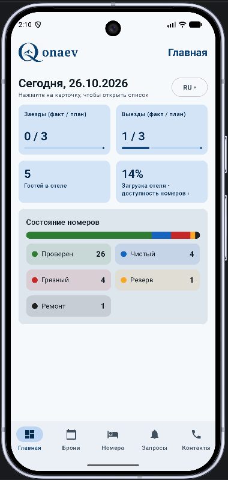 | 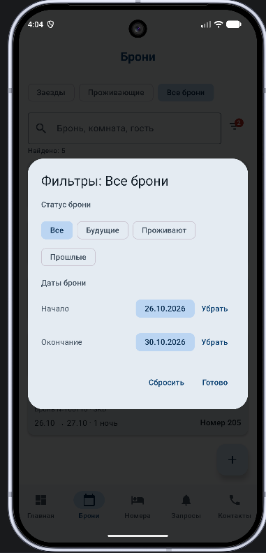 | 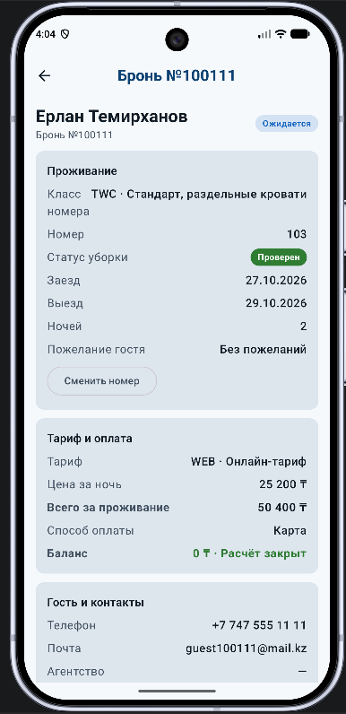 |

| Паспорт и заселение | Биллинг | Номера |
|---|---|---|
| 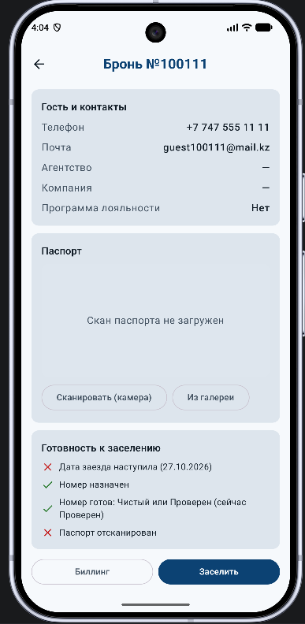 | 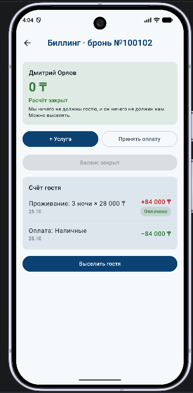 | 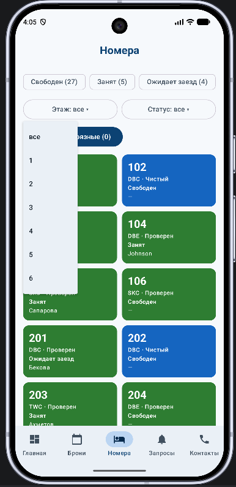 |

| Запросы | Новый запрос |
|---|---|
| 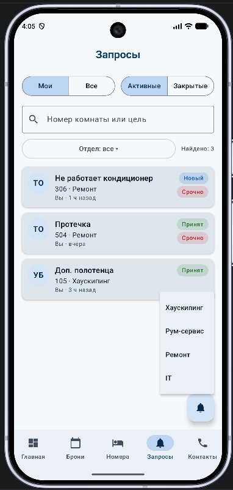 | 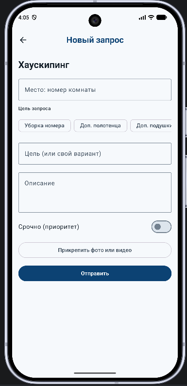 |

## Дополнительная функция Task 3: кассовая смена ресепшена

Администратор работает **сменами**. Пока смена не открыта, принять оплату, депозит или сделать возврат нельзя. Это связывает новую функцию с остальным приложением: биллинг, создание брони и главная зависят от неё.

| Смена открыта: итоги и операции | Закрытие смены с разницей | Детали закрытой смены |
|---|---|---|
| 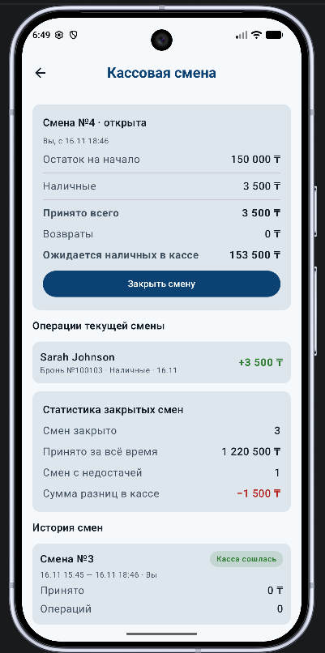 | 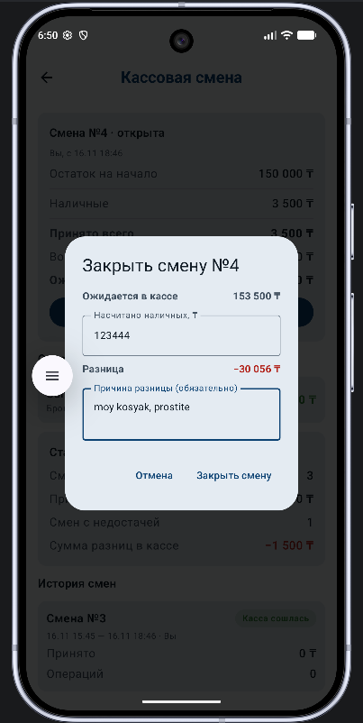 | 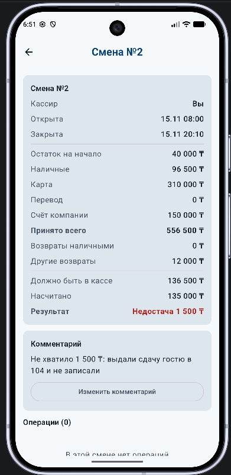 |

| Оплата со способом (попадает в смену) | Правка и удаление с подтверждением |
|---|---|
| 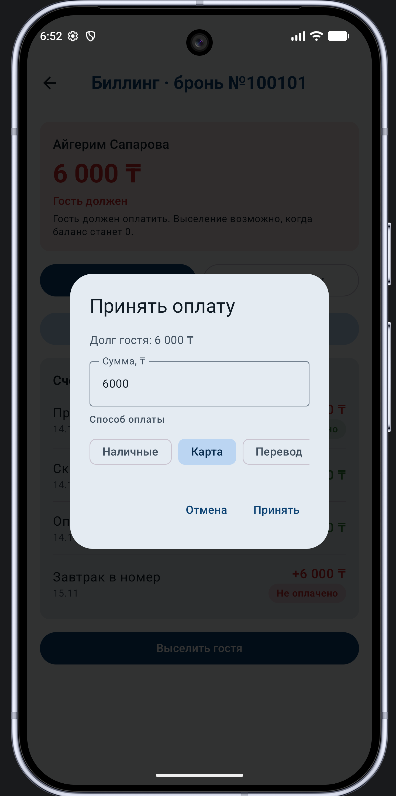 | 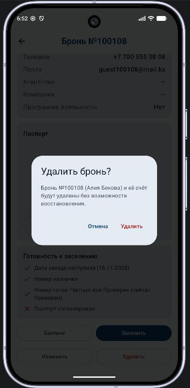 |

Как работает:

1. **Открытие.** Кассир вводит остаток наличных в кассе. Одновременно открыта только одна смена.
2. **Работа.** Каждая оплата, возврат или депозит записывается в открытую смену вместе со **способом оплаты** (наличные, карта, перевод, счёт компании). Итоги смены считаются на лету из счетов гостей, поэтому оплата в биллинге сразу видна на экране смены и на главной.
3. **Закрытие.** Кассир вводит, сколько наличных насчитал. Система сравнивает с ожидаемой суммой: `остаток на начало + принятые наличные − возвраты наличными`. Если есть разница (излишек или недостача), обязателен комментарий с причиной. Итоги записываются в смену и больше не меняются, даже если потом удалить бронь.
4. **История и статистика.** Список закрытых смен, число смен, сумма принятого, число смен с недостачей, сумма разниц. Закрытую смену можно открыть, изменить комментарий или удалить (с подтверждением). Открытую смену удалить нельзя.
5. **Сброс демо-данных** (внизу экрана смены): база заполняется стартовыми данными заново.

## Хранение данных: Room

Все данные лежат в базе **Room** (SQLite), файл `hotel.db`. Они сохраняются после закрытия и перезапуска приложения.

| Таблица (Entity) | Что хранит |
|---|---|
| `rooms` | номера, этаж, класс, статус уборки |
| `reservations` | брони |
| `folio` | строки счёта гостя (ссылаются на бронь, при удалении брони удаляются сами: `ForeignKey CASCADE`) |
| `requests` | запросы в отделы |
| `shifts` | кассовые смены |

- **DAO** (`HotelDao.kt`): запросы `@Query`, запись `@Upsert`, удаление, чтение через `Flow`. Связь «бронь + её счёт» читается одним запросом (`@Relation`, `@Transaction`).
- **CRUD:** создание, чтение, правка и удаление есть для броней, запросов и смен. Каждая кнопка в интерфейсе реально пишет в базу.
- **Flow из Room управляет UI.** Репозиторий склеивает потоки таблиц в один `StateFlow<HotelData>`. После любой записи Room сам присылает новые данные, и все экраны обновляются без ручного обновления. Оплата на экране биллинга сразу меняет итоги смены, главную и карточку брони.
- **Транзакции.** Каждое действие (`mutate`) выполняется одной транзакцией: прочитать, применить правило, записать изменённое. Если правило нарушено, запись откатывается и пользователь видит причину.

## CRUD, проверка ввода и подтверждение удаления

- **Брони:** создание, правка (`Брони → карточка → Изменить`), удаление. У проживающего гостя можно менять только контакты и оплату. Выселенную бронь править нельзя. Проживающую бронь удалить нельзя.
- **Запросы:** создание, правка (`Изменить` в окне запроса), удаление, смена статуса.
- **Смены:** открытие, закрытие, правка комментария, удаление.
- **Проверка ввода:** ошибки показываются под полями (имя, фамилия, телефон от 7 цифр, почта, число ночей 1–60, сумма больше нуля, причина разницы в кассе). Правила проверяются и в слое данных.
- **Удаление** всегда через окно подтверждения (`ConfirmDialog`).
- **Пустые состояния:** «Запросов нет», «Закрытых смен пока нет», «Пока нет операций» и т. д. Результат действий показывается в Snackbar.
- **Списки** на `LazyColumn` со стабильными ключами (`key`).

## Возможности (Midterm)

1. **Главная (Dashboard).** Статистика дня в четырёх карточках: Arrivals, Departures, «Гостей в отеле» и «Загрузка отеля». Все карточки нажимаются и ведут в нужный список броней или на полноэкранную таблицу доступности номеров на 7 дней. Блок «Состояние номеров» показывает цветную полосу пропорций и плитки по пяти статусам уборки. Здесь же выбор языка.
2. **Брони.** Вкладки Arrivals, In-house и «Все брони», поиск по номеру комнаты, брони и гостю. Остальные фильтры спрятаны в окно (значок фильтра с цифрой включённых): диапазон заездов, проживающие / выселенные / все, статус и дата. Создание новой брони с проверкой доступности и тарифом (BAR / WEB / CORP).
3. **Автоназначение номера.** Для скорых заездов номер подбирается сам: класс брони, свободные даты, чистота номера, пожелание гостя.
4. **Карточка брони.** Даты, класс, цена и итого, способ оплаты, контакты, компания, лояльность. Скан паспорта (камера или галерея) при заселении, чек-лист условий заселения.
5. **Биллинг.** Услуги и платежи, баланс. Выселение возможно только при балансе 0. Больше 0: гость должен, меньше 0: предоплата.
6. **Номера.** Сетка номеров с цветами статусов: Inspected (зелёный), Clean (синий), Dirty (красный), Pickup (жёлтый), Maintenance (чёрный). Фильтры: занятость (чипы), этаж и статус уборки (выпадающие списки). Смена статуса по правилам, кнопка «Убрать все Dirty» (корутины).
7. **Запросы отделам (как в Sara).** Две группы переключателей: «Мои / Все» и «Активные / Закрытые». Выбор отдела выпадающим списком, поиск по комнате, создание запроса с фото и видео, смена статуса.
8. **Контакты.** Внутренние телефоны отделов в сворачиваемых группах, при поиске группы раскрываются сами.
9. **Два языка (RU / EN).** Переключатель на главной, выбор запоминается. Переводится весь интерфейс, данные гостей не меняются.
10. **Тема.** Material 3, акцентный синий цвет из логотипа Qonaev, светлая и тёмная темы.

Классы номеров: DBC (стандарт), TWC (раздельные кровати), DBE (улучшенный стандарт), SKD (полулюкс), SKC (люкс).

## Как запустить

1. Установить Android Studio (версия с поддержкой AGP 9.x).
2. Открыть папку проекта (`File → Open`).
3. `File → Sync Project with Gradle Files`.
4. Выбрать эмулятор или телефон (Android 8.0, API 26 и выше) и нажать **Run**.

Данные хранятся в базе Room и сохраняются после перезапуска. При первом запуске база заполняется демо-данными (кнопка «Сбросить демо-данные» на экране смены возвращает их). При повороте экрана всё сохраняется.

Если после обновления проекта Gradle не синхронизируется, проверьте, что подключён плагин KSP (`libs.versions.toml`, версия `ksp` должна подходить к версии Kotlin).

## Архитектура

Код разделён на слои. Пакет один, слои разделены по файлам.

| Слой | Файлы | Что делает |
|---|---|---|
| Данные | `Models.kt`, `SeedData.kt`, `HotelEntities.kt`, `HotelDao.kt`, `HotelDatabase.kt`, `HotelRepository.kt` | Модели, таблицы Room, DAO, база и репозиторий (единственный вход к базе) |
| Правила (Domain) | `HotelOperations.kt`, `HotelRules.kt`, `ShiftRules.kt`, `Format.kt` | Чистые функции без Android и Room: операции над данными, занятость, смена, итоги |
| Язык | `I18n.kt` | Словарь и функция `tr()`, переводят показываемый текст RU / EN |
| Бизнес-правила | `HotelRules.kt`, `Format.kt` | Чистые функции: занятость, свободные номера, автоназначение, доступность, фильтры |
| Состояние | `*ViewModel.kt` | `StateFlow`, фильтры, действия экранов |
| UI | `*Screen.kt`, `Components.kt`, `FilterComponents.kt`, `TopBar.kt`, `AvailabilityScreen.kt`, `HotelTheme.kt`, `HotelIcons.kt` | Экраны на Compose и переиспользуемые компоненты |
| Навигация | `HotelScreen.kt` | `NavHost`, нижняя панель, создание ViewModel |
| Приложение | `HotelApp.kt` | Класс `Application`: открывает базу и создаёт репозиторий при запуске |

Как это связано:

- **Navigation Compose.** 5 разделов в нижней панели и экраны поверх них (карточка брони, биллинг, новая и правка брони, новый и правка запроса, доступность номеров, кассовая смена, детали смены). Параметры передаются в маршруте (`reservation/{id}`). Переключение разделов сохраняет состояние каждого (`saveState` / `restoreState`).
- **ViewModel и StateFlow.** Экран подписывается через `collectAsStateWithLifecycle()`, то есть только пока он виден. Состояние собирается операторами `combine` и `stateIn`.
- **Единый источник данных.** Источник правды: база Room. Репозиторий отдаёт `StateFlow` из таблиц, ViewModel'и преобразуют его для экранов. Экраны данные не меняют, а вызывают методы ViewModel, ViewModel запускает корутину и вызывает `suspend`-метод репозитория.
- **State hoisting.** Экраны получают состояние и колбэки параметрами, состояние поднято в ViewModel.
- **remember и rememberSaveable.** Введённый текст и поля форм хранятся через `rememberSaveable` (переживают поворот), мелкие UI-флаги через `remember`.
- **Корутины.** `viewModelScope`, `async` / `awaitAll`, `withContext(Dispatchers.IO)` для файлов.

## Структура проекта

```
app/src/main/java/com/example/hotelreception/
├── MainActivity.kt
├── HotelScreen.kt            навигация
├── HotelApp.kt               Application (база и репозиторий)
├── Models.kt  SeedData.kt  Format.kt
├── HotelEntities.kt  HotelDao.kt  HotelDatabase.kt  HotelRepository.kt   Room
├── HotelOperations.kt  HotelRules.kt  ShiftRules.kt                      правила
├── HotelViewModel.kt  DashboardViewModel.kt  ReservationsViewModel.kt
├── RoomsViewModel.kt  RequestsViewModel.kt  ContactsViewModel.kt  ShiftViewModel.kt
├── Components.kt  HotelTheme.kt  HotelIcons.kt  Media.kt
└── DashboardScreen.kt  ReservationsScreen.kt  ReservationDetailsScreen.kt
    BillingScreen.kt  NewReservationScreen.kt  RoomsScreen.kt
    RequestsScreen.kt  NewRequestScreen.kt  ContactsScreen.kt
    ShiftScreen.kt  ShiftDetailsScreen.kt
```

## Что можно попробовать в демо

- Главная: нажать карточку «Загрузка отеля» (таблица доступности), Arrivals, Departures; переключить язык.
- Брони → Arrivals: у сегодняшних заездов номер уже назначен автоматически.
- Sarah Johnson (In-house): баланс больше 0, выселить нельзя, пока не оплатит.
- Zhang Wei: баланс меньше 0 (предоплата).
- Заселение без скана паспорта запрещено.
- Номера: фильтр по этажу и статусу, смена статуса, «Убрать все Dirty».
- Запросы: создать запрос в отдел с фото, найти по номеру комнаты.
- Главная → «Кассовая смена»: смена уже открыта. Брони → In-house → Sarah Johnson → Биллинг → «Принять оплату» (выбрать способ), потом вернуться на экран смены: итоги изменились сами.
- Закрыть смену с неверной суммой наличных: система потребует причину.
- Брони → карточка → «Изменить» и «Удалить» (с подтверждением). Запросы → нажать запрос → «Изменить» / «Удалить».
- Закрыть приложение полностью и открыть снова: данные на месте.
- Повернуть экран: введённые фильтры и формы сохраняются.
