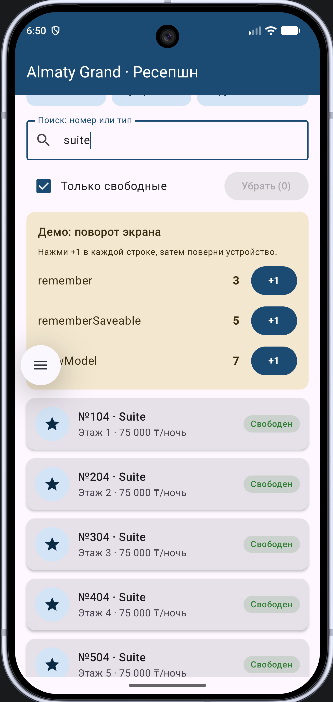
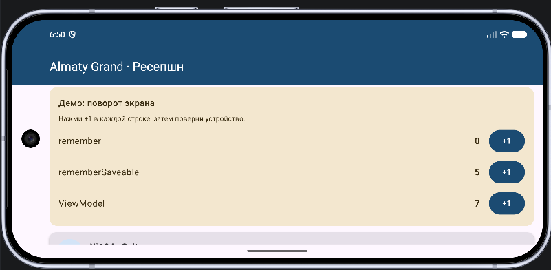
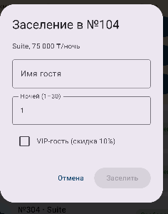
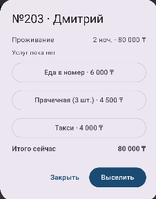
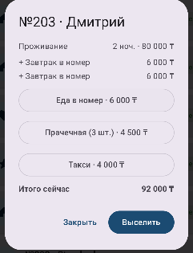

# Hotel Reception (Android)

This is the Android version of my HW1 console project. In HW1 the hotel reception ran in the terminal with `println` and a menu. Now the same hotel, Almaty Grand, has a real screen: a list of rooms, check-in, room service, check-out with a bill and housekeeping.

Built with Kotlin, Jetpack Compose and Material 3. State lives in a `ViewModel`.

## What it does

- Shows 20 rooms (5 floors, Standard / Deluxe / Suite) in a `LazyColumn`.
- Search by room number or type, plus an "only free rooms" checkbox.
- Tap a free room to check a guest in (name, number of nights, VIP checkbox).
- Tap an occupied room to order food, laundry or a taxi, or to check the guest out and get the bill. VIP guests get 10% off.
- Checked-out rooms become "dirty". The "Clean" button sends housekeeping to all of them at once (coroutines, same idea as `async/awaitAll` in HW1).
- Top row shows occupied rooms, rooms waiting for cleaning and revenue.
- A yellow card at the top demonstrates what happens to state when the screen is rotated.

## How to run

1. Open the project in Android Studio and wait for Gradle sync to finish.
2. Pick an emulator (or a phone with USB debugging) in the device list.
3. Press Run.

## Project structure

Everything is in the package `com.example.hotelreception`, in `app/src/main/java/...`.

| File | What is inside |
| --- | --- |
| `Models.kt` | `RoomType`, `Room`, `Guest`, `Booking` and the sealed class `ServiceOrder` (from HW1) |
| `HotelViewModel.kt` | `HotelUiState` and `HotelViewModel`: search, check-in, services, check-out, cleaning |
| `Components.kt` | Reusable composables: `StatusBadge`, `SearchField`, `RoomCard`, `StatCard`, `InfoRow`, `StateDemoCard` |
| `HotelScreen.kt` | The main screen and the three dialogs (check-in, booking details, bill) |
| `HotelIcons.kt` | Small vector icons drawn in code |
| `HotelTheme.kt` | Material 3 colors |
| `MainActivity.kt` | Entry point, just calls `HotelScreen()` |

The UI never changes data by itself. A composable calls a function of the `ViewModel`, the `ViewModel` puts a new `HotelUiState` into a `StateFlow`, and the screen redraws from it.

## Screenshots and what they show

### 1. Main screen before rotation (portrait)

This is the main screen with a search for `suite` and the "Only free" checkbox ticked, so the list shows only free Suites (rooms 104, 204, 304, 404, 504), each with a green "Free" badge. The "Clean (0)" button is greyed out because no room is waiting for cleaning.

On the yellow demo card I pressed `+1` for `remember` 3 times, for `rememberSaveable` 5 times and for `ViewModel` 7 times, so the counters read 3, 5 and 7.

### 2. Main screen after rotation (landscape)

Same app after turning the emulator to landscape. The `remember` counter dropped back to 0, while `rememberSaveable` is still 5 and `ViewModel` is still 7.

A rotation destroys the Activity and creates a new one, so the composition starts from scratch and everything stored with plain `remember` is lost. `rememberSaveable` writes its value into the `Bundle` that Android saves and gives to the new Activity, so it survives. The `ViewModel` is kept by Android in a separate store that lives through configuration changes, so `viewModel()` returns the same object after the rotation. The search text and the checkbox from screenshot 1 are also kept in the `ViewModel` (in `HotelUiState`), which is why they do not reset either.

### 3. Check-in dialog

I tapped the free Suite 104. The dialog shows the room type and the price per night (Suite, 75 000 ₸). It has a text field for the guest name, a numeric field for the nights (1 to 30) and a checkbox for a VIP guest (10% discount).

The "Check in" button is disabled because the name is empty. It becomes active only when the name is not blank and the number of nights is valid. This is the second user interaction besides search and filtering: adding a guest. The fields of this form are stored with `rememberSaveable`, so a half-typed name survives a rotation, and they do not need to be in the `ViewModel` because they only matter while the dialog is open.

### 4. Booking dialog without services

I tapped the occupied room 203 (guest Dmitry, 2 nights). The dialog shows the stay cost (2 nights × 40 000 ₸ = 80 000 ₸) and "No services yet". Three buttons order food, laundry or a taxi, and "Check out" closes the stay and shows the bill. The total at the bottom is 80 000 ₸.

### 5. Booking dialog after ordering services

Here I pressed "Food to the room" twice. Two lines of 6 000 ₸ appeared in the list and the total changed from 80 000 ₸ to 92 000 ₸ (80 000 + 6 000 + 6 000). Dmitry is not a VIP, so there is no discount. The dialog updates immediately because the `ViewModel` puts a new `Booking` into the state and the UI redraws from it.

When there are many orders, the list of services has a maximum height and scrolls by itself, while the order buttons and the total stay in place.

## remember vs rememberSaveable vs ViewModel

| | `remember` | `rememberSaveable` | `ViewModel` |
| --- | --- | --- | --- |
| Survives rotation | no | yes | yes |
| Survives the system killing the process | no | yes | no |
| Used here for | the demo counter | the demo counter, the fields of the check-in dialog | rooms, bookings, search, filter, revenue |
| Good for | tiny temporary UI state | small things the user would be annoyed to lose (typed text) | screen state and logic |

## Requirements checklist

| Requirement | Where |
| --- | --- |
| Kotlin + Compose + Material 3 | whole project, theme in `HotelTheme.kt` |
| 3+ reusable composables | `Components.kt` |
| `Row`, `Column`, `Box` | `RoomCard`, `HotelScreen` |
| `LazyColumn`, `Card`, `Text`, `Image` | `HotelScreen`, `RoomCard` |
| 2+ user interactions | search, filter, check-in, services, check-out, cleaning |
| `TextField`, `Button`, `Checkbox` | search field, check-in dialog, filter row |
| `remember` / `rememberSaveable` | `StateDemoCard`, `CheckInDialog` |
| `ViewModel`, UI separated from state | `HotelViewModel.kt`, `collectAsState()` in `HotelScreen` |
| State on rotation | screenshots 1 and 2 |

## Known limits

Data is kept in memory only, so closing the app resets the hotel to its starting state. Saving to a database (Room) would be the next step.
