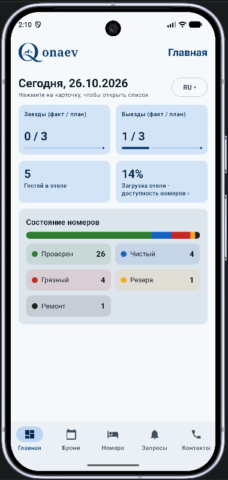
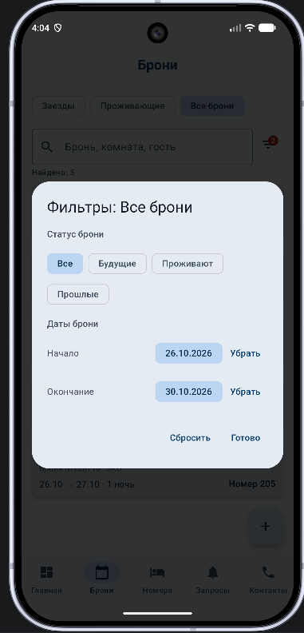
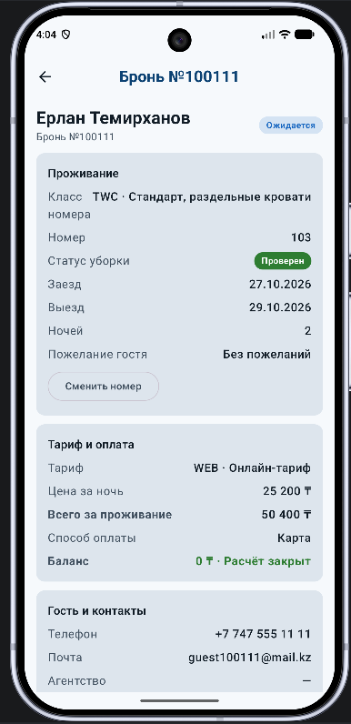
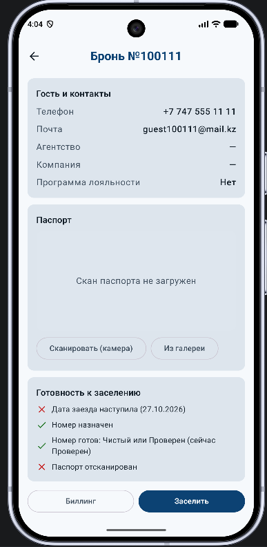
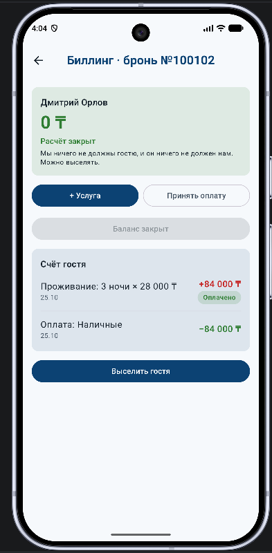
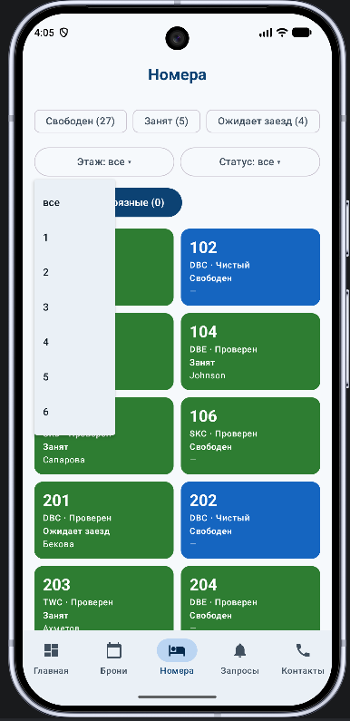
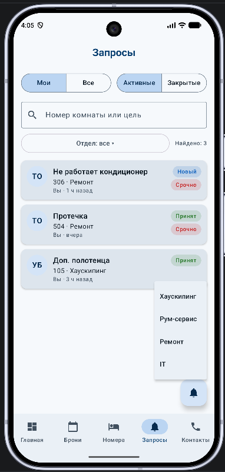
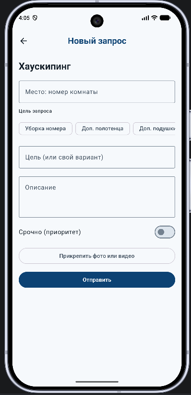

# Hotel Reception — Qonaev

Android-приложение для администратора отеля (ресепшен): брони, заселение и выселение, биллинг, статусы номеров, внутренние запросы отделам и список телефонов. Midterm Project — Android Application (Part 1).

Стек: Kotlin, Jetpack Compose, Material 3, Navigation Compose, ViewModel + StateFlow, корутины.

## Скриншоты

| Главная | Брони (фильтры) | Карточка брони |
|---|---|---|
|  |  |  |

| Паспорт и заселение | Биллинг | Номера |
|---|---|---|
|  |  |  |

| Запросы | Новый запрос |
|---|---|
|  |  |

## Возможности

1. **Главная (Dashboard).** Статистика дня в четырёх карточках: Arrivals, Departures, «Гостей в отеле» и «Загрузка отеля». Все карточки нажимаются и ведут в нужный список броней или на полноэкранную таблицу доступности номеров на 7 дней. Блок «Состояние номеров» показывает цветную полосу пропорций и плитки по пяти статусам уборки. Здесь же выбор языка.
2. **Брони.** Вкладки Arrivals, In-house и «Все брони», поиск по номеру комнаты, брони и гостю. Остальные фильтры спрятаны в окно (значок фильтра с цифрой включённых): диапазон заездов, проживающие / выселенные / все, статус и дата. Создание новой брони с проверкой доступности и тарифом (BAR / WEB / CORP).
3. **Автоназначение номера.** Для скорых заездов номер подбирается сам: класс брони, свободные даты, чистота номера, пожелание гостя.
4. **Карточка брони.** Даты, класс, цена и итого, способ оплаты, контакты, компания, лояльность. Скан паспорта (камера или галерея) при заселении, чек-лист условий заселения.
5. **Биллинг.** Услуги и платежи, баланс. Выселение возможно только при балансе 0. Больше 0: гость должен, меньше 0: предоплата.
6. **Номера.** Сетка номеров с цветами статусов: Inspected (зелёный), Clean (синий), Dirty (красный), Pickup (жёлтый), Maintenance (чёрный). Фильтры: занятость (чипы), этаж и статус уборки (выпадающие списки). Смена статуса по правилам, кнопка «Убрать все Dirty» (корутины).
7. **Запросы отделам (как в Sara).** Две группы переключателей: «Мои / Все» и «Активные / Закрытые». Выбор отдела выпадающим списком, поиск по комнате, создание запроса с фото и видео, смена статуса.
8. **Контакты.** Внутренние телефоны отделов в сворачиваемых группах, при поиске группы раскрываются сами.
9. **Два языка (RU / EN).** Переключатель на главной, выбор запоминается. Переводится весь интерфейс, данные гостей не меняются.
10. **Тема.** Material 3, акцентный синий цвет из логотипа Qonaev, светлая и тёмная темы.

Классы номеров: DBC (стандарт), TWC (раздельные кровати), DBE (улучшенный стандарт), SKD (полулюкс), SKC (люкс).

## Как запустить

1. Установить Android Studio (версия с поддержкой AGP 9.x).
2. Открыть папку проекта (`File → Open`).
3. `File → Sync Project with Gradle Files`.
4. Выбрать эмулятор или телефон (Android 8.0, API 26 и выше) и нажать **Run**.

Данные хранятся в памяти и сбрасываются при полном закрытии приложения. При повороте экрана всё сохраняется.

## Архитектура

Код разделён на слои. Пакет один, слои разделены по файлам.

| Слой | Файлы | Что делает |
|---|---|---|
| Данные | `Models.kt`, `SeedData.kt`, `HotelRepository.kt` | Классы данных, стартовые данные, хранилище (`MutableStateFlow<HotelData>`) и операции над ним |
| Язык | `I18n.kt` | Словарь и функция `tr()`, переводят показываемый текст RU / EN |
| Бизнес-правила | `HotelRules.kt`, `Format.kt` | Чистые функции: занятость, свободные номера, автоназначение, доступность, фильтры |
| Состояние | `*ViewModel.kt` | `StateFlow`, фильтры, действия экранов |
| UI | `*Screen.kt`, `Components.kt`, `FilterComponents.kt`, `TopBar.kt`, `AvailabilityScreen.kt`, `HotelTheme.kt`, `HotelIcons.kt` | Экраны на Compose и переиспользуемые компоненты |
| Навигация | `HotelScreen.kt` | `NavHost`, нижняя панель, создание ViewModel |

Как это связано:

- **Navigation Compose.** 5 разделов в нижней панели и 5 экранов поверх них (карточка брони, биллинг, новая бронь, новый запрос, доступность номеров). Параметры передаются в маршруте (`reservation/{id}`). Переключение разделов сохраняет состояние каждого (`saveState` / `restoreState`).
- **ViewModel и StateFlow.** Экран подписывается через `collectAsStateWithLifecycle()`, то есть только пока он виден. Состояние собирается операторами `combine` и `stateIn`.
- **Единый источник данных.** Репозиторий отдаёт `StateFlow`, ViewModel'и преобразуют его для экранов. Экраны данные не меняют, а вызывают методы ViewModel.
- **State hoisting.** Экраны получают состояние и колбэки параметрами, состояние поднято в ViewModel.
- **remember и rememberSaveable.** Введённый текст и поля форм хранятся через `rememberSaveable` (переживают поворот), мелкие UI-флаги через `remember`.
- **Корутины.** `viewModelScope`, `async` / `awaitAll`, `withContext(Dispatchers.IO)` для файлов.

## Структура проекта

```
app/src/main/java/com/example/hotelreception/
├── MainActivity.kt
├── HotelScreen.kt            навигация
├── Models.kt  SeedData.kt  HotelRepository.kt  HotelRules.kt  Format.kt
├── HotelViewModel.kt  DashboardViewModel.kt  ReservationsViewModel.kt
├── RoomsViewModel.kt  RequestsViewModel.kt  ContactsViewModel.kt
├── Components.kt  HotelTheme.kt  HotelIcons.kt  Media.kt
└── DashboardScreen.kt  ReservationsScreen.kt  ReservationDetailsScreen.kt
    BillingScreen.kt  NewReservationScreen.kt  RoomsScreen.kt
    RequestsScreen.kt  NewRequestScreen.kt  ContactsScreen.kt
```

## Что можно попробовать в демо

- Главная: нажать карточку «Загрузка отеля» (таблица доступности), Arrivals, Departures; переключить язык.
- Брони → Arrivals: у сегодняшних заездов номер уже назначен автоматически.
- Sarah Johnson (In-house): баланс больше 0, выселить нельзя, пока не оплатит.
- Zhang Wei: баланс меньше 0 (предоплата).
- Заселение без скана паспорта запрещено.
- Номера: фильтр по этажу и статусу, смена статуса, «Убрать все Dirty».
- Запросы: создать запрос в отдел с фото, найти по номеру комнаты.
- Повернуть экран: введённые фильтры и формы сохраняются.
